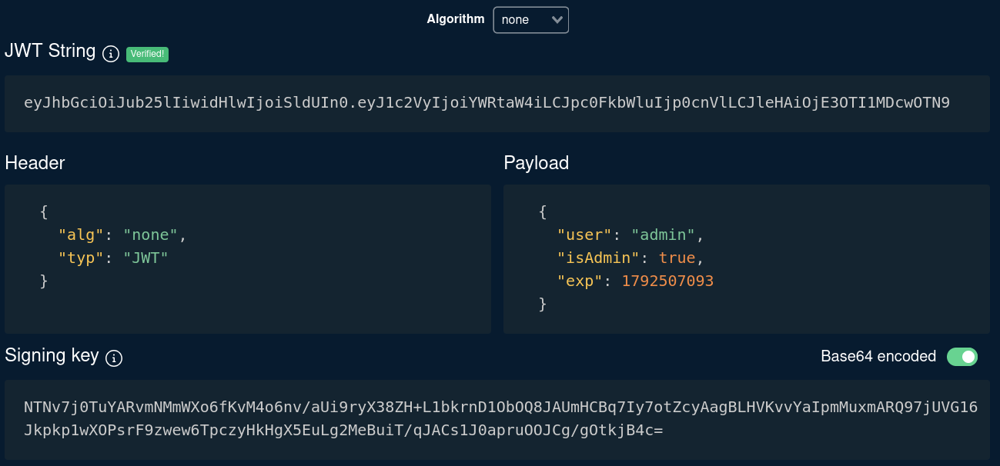

**JWT signature verification** vulnerabilities occur when an application accepts tokens without correctly validating their integrity. If the server trusts claims such as isAdmin, role, or user without verifying that they were issued by a trusted authority, an attacker may be able to modify the token and escalate privileges.

---

## Missing Signature Verification

### JWT Claims and Trust Boundaries

A JSON Web Token (JWT) commonly consists of three Base64URL-encoded components separated by periods:

```
header.payload.signature
```

The header specifies the token type and signing algorithm, the payload contains claims, and the signature protects the integrity of the header and payload.

The payload is not encrypted by default. Anyone who obtains a JWT can generally decode and read its claims. However, changing a claim invalidates the original signature, so a correctly implemented application must reject the modified token.

A vulnerability occurs when the application decodes the payload and trusts its contents without validating the signature. An attacker may then change authorization-related claims, such as `isAdmin`, to gain privileges that were never granted by the server.

### Identifying the Vulnerability

Start by authenticating to the target application and inspecting the HTTP response in Burp Suite. Look for a JWT in a cookie or authorization header.

For example, a login response might contain:

```
HTTP/1.1 200 OK
Set-Cookie: session=<REDACTED_JWT>; HttpOnly; Path=/
Content-Type: application/json

{"message":"Login successful"}
```

Decode the token using Burp Suite extensions, CyberChef, or a local JWT decoder. An example payload might look like this:

```
{
  "user": "analyst",
  "isAdmin": false,
  "exp": 1792512000
}
```

The `isAdmin` claim is a potential privilege escalation target. Its presence alone does not prove a vulnerability; the server might ignore it and derive authorization from a database or another trusted source.

### Testing Claim Manipulation

In an authorized lab, modify `isAdmin` from `false` to `true`, then send the altered token to an endpoint that requires administrator privileges.

For example, the original request might be:

```
GET /admin HTTP/1.1
Host: target.htb
Cookie: session=<ORIGINAL_JWT>
```

After modifying the payload and re-encoding it, the token will no longer have a valid signature unless it is signed correctly with the expected key. To test whether the server improperly skips verification, send the modified token with its original signature and observe the response.

```
GET /admin HTTP/1.1
Host: target.htb
Cookie: session=<MODIFIED_JWT_WITH_ORIGINAL_SIGNATURE>
```

If the application grants administrator access despite the invalid signature, this strongly indicates missing or ineffective signature verification. A `200 OK` response alone is insufficient proof; confirm that the response exposes functionality or data unavailable to the original user.

---

## The none Algorithm Attack

### How the Unsigned JWT Algorithm Works

The JWT header's `alg` field specifies the algorithm used to protect the token. The special value `none` represents an unsecured JWT with no cryptographic signature.

An unsecured JWT typically has this structure:

```
base64url(header).base64url(payload).
```

>Notice the trailing period, it separates the payload from the empty signature component and needs to be included.

The `none` algorithm is not inherently a vulnerability. The security issue arises when an application accepts unsigned tokens in a context where authenticated or signed tokens are required. Modern JWT libraries generally restrict unsecured tokens unless explicitly configured to allow them.

### Constructing an Unsigned Token

In an authorized test environment, create a JWT with a header specifying `alg: none` and a payload containing a test identity. Use a non-privileged test account or a designated lab administrator claim.



Both JSON objects are Base64URL-encoded without padding and joined with a period. The final signature component is empty.

The resulting format is:

```
<BASE64URL_HEADER>.<BASE64URL_PAYLOAD>.
```

> The final period (`.`) must be present because a JWT consists of three components: `header.payload.signature`. When using `alg: none`, the signature is empty, but the third component must still be represented.


### Testing the Forged Token

Send the unsigned JWT in the session cookie and access an endpoint restricted to administrators:

```
GET /admin HTTP/1.1
Host: target.htb
Cookie: session=<UNSIGNED_JWT>
```

If the application accepts the token and grants administrator access, it indicates that the backend may be accepting unsigned JWTs and trusting their claims without proper signature verification.

This could happen because the backend fails to enforce an explicit signing algorithm allowlist and permits `alg: none` for a session that should require a valid signature. The correct fix is to reject unsigned tokens and verify signatures using the expected algorithm and trusted key.