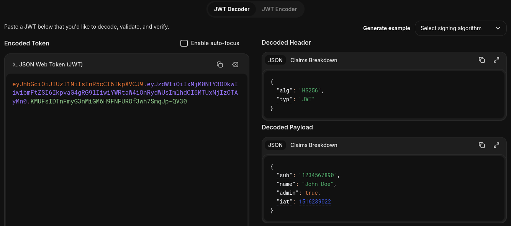
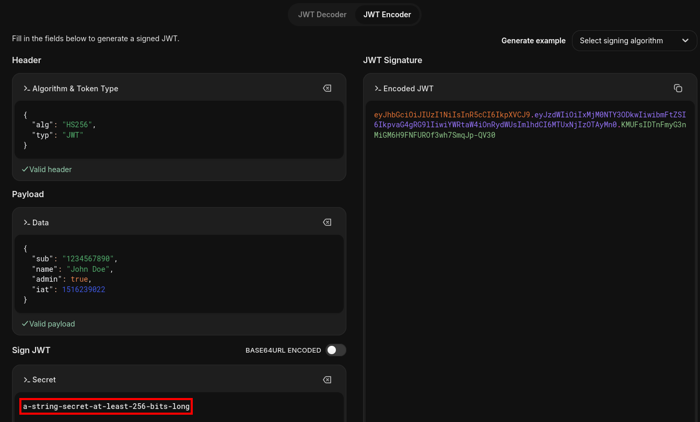

**A JWT signing secret attack** occurs when an application uses a weak or guessable secret to sign JWTs with a symmetric algorithm. If an attacker recovers the secret, they can generate valid signatures for modified tokens and potentially escalate privileges.

Unlike attacks that bypass signature verification, this technique does not disable the verification mechanism. Instead, the attacker obtains the secret required to produce a valid signature.

---

## Obtaining the JWT

First, authenticate to the application and capture a valid JWT from the HTTP response. The token is commonly stored in a session cookie or returned in the response body.

For example:

```
POST /login HTTP/1.1
Host: target.htb
Content-Type: application/x-www-form-urlencoded

username=analyst&password=<REDACTED_PASSWORD>
```

The response may contain a session token:

```
HTTP/1.1 302 Found
Set-Cookie: session=<JWT_TOKEN>; HttpOnly; Path=/
```

Decode the JWT header to identify the signing algorithm:



The algorithms `HS256`, `HS384`, and `HS512` use HMAC with a shared secret. Both the token issuer and the verifier must have access to the appropriate secret.

If the secret is weak, predictable, or reused from a common password, an attacker may be able to recover it through offline guessing.


---

## Cracking the Signing Secret

### Using Hashcat

Hashcat supports JWT secret recovery through mode `16500`. It tests candidate secrets against the token's signature to determine whether a candidate produces a valid match.

Save the captured JWT to a file:

```
echo -n '<JWT_TOKEN>' > jwt.txt
```

Run Hashcat against a wordlist in an authorized lab:

```
hashcat -m 16500 jwt.txt /usr/share/wordlists/rockyou.txt
```

To display a recovered secret:

```
hashcat -m 16500 jwt.txt /usr/share/wordlists/rockyou.txt --show
```

If a candidate secret matches the token's signature, Hashcat reports it as recovered.

---

## Forging a Valid JWT

### Modifying the Payload

Once the signing secret has been recovered, we can use [jwt.io](https://www.jwt.io/) to modify the JWT and generate a new valid signature.

Paste the original JWT into the **Encoded** section. In the **Decoded** section, modify the desired claims, for example, changing `isAdmin` from `false` to `true`:




Next, enter the recovered signing secret in the **Sign JWT** section, ensuring that the selected algorithm matches the original JWT (e.g., `HS256`). JWT.io will calculate the signature using the modified header and payload and the provided secret.

The resulting JWT contains the modified claims and a valid signature, allowing us to test whether the application trusts these claims for authorization.


### Sending the Forged Token

Replace the original session token with the newly signed JWT and access a protected endpoint:

```
GET /admin HTTP/1.1
Host: target.htb
Cookie: session=<FORGED_JWT>
```

If the application accepts the token and relies on the modified claim for authorization, the attacker may gain administrator access.

A valid signature does not guarantee that every modified claim will be trusted: the backend may independently check user roles, account status or permissions.

