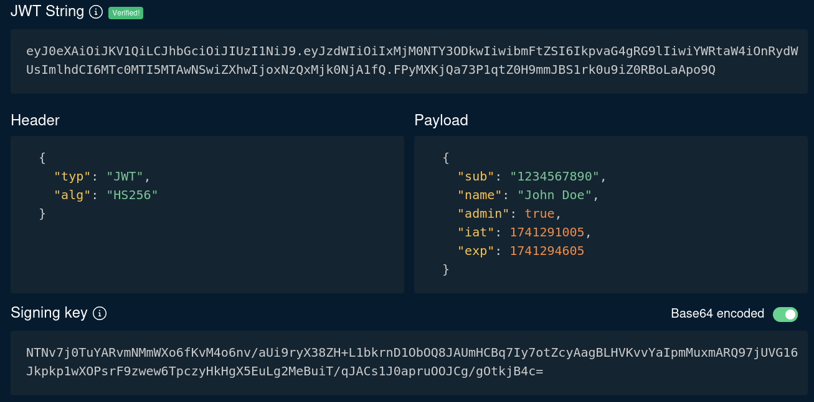

A **JSON Web Token (JWT)** is a standard format for transferring claims between two parties in a way that can be verified. In web applications it is most commonly used as a session token: instead of handing the client an opaque random string, the server hands it a structured, signed JSON document that already contains the user's identity and privileges.

A JWT is defined by a family of specifications, and it helps to know which does what:

- **JWS (JSON Web Signature):** protects the token's integrity with a signature or MAC. This is what almost every web application uses.
- **JWE (JSON Web Encryption):** encrypts the content. It is rare in practice and is not covered here.
- **JWK (JSON Web Key):** a JSON structure for representing cryptographic keys.
- **JWA (JSON Web Algorithms):** defines the algorithms allowed in the `alg` header, such as `HS256` or `RS256`.

The key point for pentesting is that a JWS-based JWT is **signed, not encrypted**. Anyone who holds the token can read its contents. The signature only guarantees that the contents were not modified.

---

## Token Structure

A JWS JWT in its compact form is three dot-separated parts: `header.payload.signature`. Each part is encoded with **base64url**, which is base64 with `-` and `_` instead of `+` and `/`, and with the `=` padding removed. This matters when decoding by hand, because plain `base64 -d` will fail or produce garbage unless you convert the alphabet and restore the padding.

```text
eyJhbGciOiJIUzI1NiIsInR5cCI6IkpXVCJ9.<payload>.<signature>
```

[token.dev](https://token.dev) or [jwt.io](https://www.jwt.io/) are useful tools for inspecting and manipulating JWTs:



### Header

The header holds metadata needed to interpret the token. The two most common parameters are `typ`, usually `JWT`, and `alg`, which declares the algorithm used to sign the token.

```json
{
  "alg": "HS256",
  "typ": "JWT"
}
```

The values accepted for `alg` come from JWA:

|`alg`|Algorithm|Key type|
|---|---|---|
|HS256 / HS384 / HS512|HMAC with SHA-2|Shared secret (symmetric)|
|RS256 / RS384 / RS512|RSASSA-PKCS1-v1_5|RSA key pair (asymmetric)|
|PS256 / PS384 / PS512|RSASSA-PSS|RSA key pair (asymmetric)|
|ES256 / ES384 / ES512|ECDSA (P-256, P-384, P-521)|EC key pair (asymmetric)|
|none|No signature|None|


### Payload

The payload carries the claims, which are the actual data of the token. Some claims are registered in the standard, and applications can add any custom claims they want.

```json
{
  "iss": "lab-issuer",
  "sub": "1042",
  "user": "jdoe",
  "isAdmin": false,
  "iat": 1760950000,
  "exp": 1760953600
}
```

The registered claims you will meet most often are:

- `iss`: who issued the token.
- `sub`: the subject, usually a user ID.
- `aud`: the intended recipient of the token.
- `exp`: expiration time as a Unix timestamp.
- `nbf`: not valid before this time.
- `iat`: when the token was issued.
- `jti`: a unique token identifier, useful for revocation.

Custom claims such as `user` or `isAdmin` are where authorization decisions usually live. When an application trusts these values blindly, forging or altering them becomes the main objective of an attacker. Since the payload is only encoded, never store secrets in it.

### Signature

The signature is calculated over `base64url(header) + "." + base64url(payload)` using the algorithm from the header and a key. For HS256 that is an HMAC-SHA256 with the shared secret. If a single byte of the header or payload changes, the signature no longer matches and verification fails. Producing a valid signature therefore requires the signing key, and recovering or bypassing that key is what most JWT attacks aim for.

---

## Stateful vs Stateless Authentication

With **stateful** authentication, the client holds only an opaque session ID, for example `4EC72A4BFF14A8CB`. On each request the server looks that ID up in a session store or database to find out who the user is and what they can do. The state lives on the server.

With **stateless** authentication, the JWT itself carries the user data. The server only needs to verify the signature, and then it can trust the claims without any lookup. This scales well and removes the need for shared session storage, which is why JWTs are popular in APIs and microservices.

The trade-off is that the server trusts whatever the signature validation says. Several practical consequences follow from that:

- A token stays valid until `exp`, even if the user logs out or is deleted, unless the application adds its own revocation list.
- Any flaw in signature verification gives the attacker full control over identity and privileges.
- Anything placed in the payload is readable by the client, so information disclosure through claims is a common finding.
