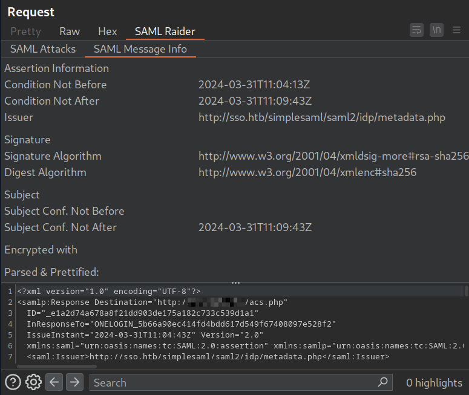

**SAML Raider** automates everything that was being done manually in the previous sections: decoding, manipulating, re-encoding, and resending SAML responses. It removes the need to script Base64/URL encode-decode cycles for every single test, which makes it the practical go-to tool once you understand the underlying attacks.

---

## Installation

Install it directly from the BApp Store inside Burp Suite:

```
Burp Suite > Extensions > BApp Store > SAML Raider > Install
```

Once installed, it hooks into the HTTP proxy and automatically detects and highlights any request containing SAML data (`SAMLRequest` or `SAMLResponse` parameters), whether in GET query strings or POST bodies.

---

## Usage 

Send a request containing a `SAMLResponse` to Burp Repeater. A new **SAML Raider** tab appears on the request. Inside it, the **SAML Message Info** sub-tab shows the decoded XML at the bottom of the window along with general metadata (issuer, destination, signature algorithm, etc.); no manual `base64 -d` needed to inspect the structure.




### SAML Attacks

The **SAML Attacks** sub-tab exposes one-click exploitation for every vulnerability class covered earlier:

- **Remove Signatures:** strips the `ds:Signature` node entirely, testing for Signature Exclusion (the parser accepting unsigned assertions as valid).
- **XSW (XML Signature Wrapping):** provides all eight documented wrapping variants (XSW1–XSW8), each corresponding to a different combination of signature placement and injection strategy. Instead of manually duplicating and repositioning the `saml:Assertion` node, you just pick the variant and SAML Raider restructures the XML automatically.
- **XXE and XSLT payload injection:** prebuilt templates to test for external entity and XSLT server-side injection, following the same injection points discussed before (DOCTYPE prolog, `ds:Transform` node).

After selecting an attack, SAML Raider rebuilds the XML, re-applies Base64 and URL encoding, and updates the `SAMLResponse` parameter in place. The only remaining step is hitting **Send** in Repeater; no manual re-encoding required.


### Certificate Management

SAML Raider also includes a certificate manager (under its own Burp tab) that lets you import, generate, and clone X.509 certificates used by the IdP. This matters for testing scenarios like self-signed certificate acceptance or certificate substitution, where the SP might trust a certificate that was never actually issued by the real IdP.
