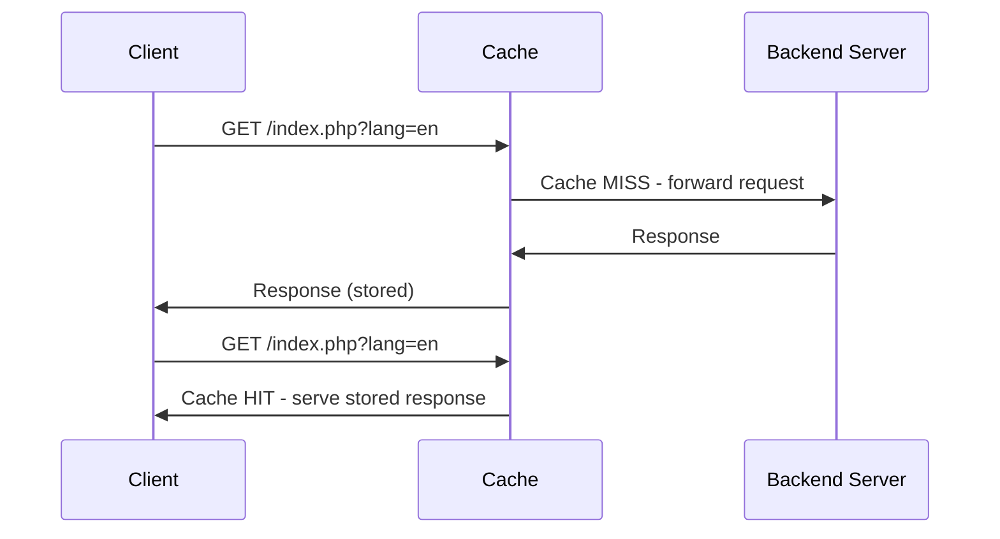

Web cache poisoning abuses the way caches store and serve responses to deliver malicious content to users who never directly interact with the attacker's payload. Because the cache serves the same poisoned response to every user whose request matches the cache key, a single successful poisoning can affect all visitors to a site, turning a reflected XSS that normally requires user interaction into something that fires automatically for anyone who loads the page.

Common web caches include Varnish, Nginx, and Squid.

---

## How Web Caches Work

A web cache sits between the client and the backend server. When a request arrives, the cache checks whether it already has a stored response for it. If it does (a cache hit), it returns the stored response without touching the backend. If it does not (a cache miss), it forwards the request to the server, stores the response, and serves it.



To decide whether two requests should receive the same cached response, the cache uses a subset of request parameters called the **cache key**. In a typical default configuration the cache key consists of the request path, GET parameters, and the `Host` header. Everything else (such as `User-Agent`, `Accept`, custom headers) is **unkeyed**, meaning it is ignored when matching requests to cached responses.

|Parameter type|Included in cache key|Effect on cache matching|
|---|---|---|
|Request path|Yes|Different paths = different cache entries|
|GET parameters|Yes (configurable)|Different values = different cache entries|
|Host header|Yes|Different hosts = different cache entries|
|User-Agent|No (default)|Ignored, same response served regardless|
|Custom headers|No (default)|Ignored unless explicitly keyed|

This distinction is the foundation of web cache poisoning: if an unkeyed parameter influences the response content, an attacker can inject a malicious value through that parameter and have it cached and served to all subsequent users who match the same cache key.

### Identifying Cache Behavior

The `X-Cache-Status` response header (present in Nginx and many other caches) reveals whether a response was served from cache or freshly fetched:

```http
GET /index.php HTTP/1.1
Host: app.corp
```

```http
HTTP/1.1 302 Found
X-Cache-Status: MISS
Location: /index.php?lang=en
```

Repeating the same request:

```http
HTTP/1.1 302 Found
X-Cache-Status: HIT
Location: /index.php?lang=en
```

A `MISS` followed by a `HIT` on the same request confirms that caching is active and the response is being stored.

---

## Cache Key Configuration

The cache key is defined in the cache configuration. A typical Nginx setup looks like:

```nginx
http {
  proxy_cache_path /cache levels=1:2 keys_zone=STATIC:10m inactive=24h max_size=1g;

  server {
    listen 80;

    location / {
      proxy_pass         http://10.10.10.5:80;
      proxy_buffering    on;
      proxy_cache        STATIC;
      proxy_cache_valid  2m;
      proxy_cache_key    $scheme$proxy_host$uri$args;
      add_header         X-Cache-Status $upstream_cache_status;
    }
  }
}
```

The `proxy_cache_key` directive defines what goes into the key. `$args` includes all GET parameters. If changed to include only a specific parameter:

```nginx
proxy_cache_key $scheme$proxy_host$uri$arg_lang;
```

Then only the `lang` parameter is keyed. Any other GET parameter becomes unkeyed, meaning two requests to `/index.php?lang=en&cb=123` and `/index.php?lang=en&cb=456` are treated as the same cache entry and served the same response, regardless of the `cb` value.
