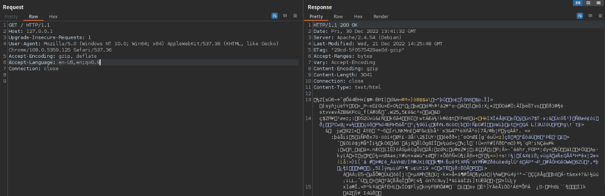

Compression reduces data size before transmission, which matters most on constrained or slow connections, where less data to transfer means faster load times and lower bandwidth consumption. In a security context, understanding where and how compression is applied is a prerequisite for later attacks that abuse it as a side channel, covered separately in CRIME and BREACH.

---

## HTTP Compression

Compression can be applied at the application layer, meaning the web server compresses the HTTP response before sending it over the wire. This is signaled to the browser through the `Content-Encoding` header, with values such as `gzip`, `br`, `zstd`, `deflate`, or the older `compress`. The browser reads this header and decompresses the body accordingly to render the page correctly.




In `HTTP/1.1`, compression only applies to the response body, all headers are always sent uncompressed, in plaintext. `HTTP/2` changes this for headers specifically, compressing them separately using `HPACK`, though the body compression behavior via `Content-Encoding` remains conceptually the same.

Most intercepting proxies, including Burp, automatically detect and decompress responses by default for readability, this needs to be explicitly disabled in proxy settings to inspect the raw, still-compressed bytes on the wire.

---

## TLS Compression

Instead of (or in addition to) application-layer compression, compression can also be applied at the TLS layer. This is a fundamentally different scope, it compresses the entire TLS record, not just the application payload, meaning the whole HTTP response including all headers gets compressed together, not just the body.

Because this happens below the application layer, it is completely transparent to any web server or intercepting proxy, Burp has no visibility into it whatsoever, there's nothing to toggle or inspect at that layer from a proxy's perspective.

Whether TLS compression is used, and which method, is negotiated during the handshake. The client advertises supported compression methods in the `ClientHello` message's `Compression Methods` field, and the server selects one of them in `ServerHello`.

TLS compression is obsolete today and was removed entirely in TLS 1.3, it only appears in legacy TLS 1.2 and earlier configurations.

---

## LZ77 as a Reference Algorithm

LZ77 is a useful algorithm to understand the mechanics of sliding-window compression, which underlies the core idea exploited by later compression-based attacks. It works by maintaining a dictionary of recently encountered strings and replacing repeated sequences with a back-reference to their earlier occurrence instead of storing the repeated text again.

Take the sentence `I like SecureCorp's SecureCorp Academy` as an example. It compresses to:

```
I like SecureCorp's <13,10> Academy
```

The second occurrence of `SecureCorp` is replaced by a two-number back-reference, a pointer (how far back to look) and a length (how many characters to copy forward). To decompress, the pointer is followed backward 13 characters, and the next 10 characters from that position are copied forward, reconstructing `SecureCorp` without having stored it twice.

The detail that matters for later attacks is the sliding window itself, LZ77 only considers a limited recent history of text, not the entire document at once. Repeated content that is close together compresses more efficiently (shorter output) than repeated content that is far apart or outside the window entirely. This size variation, driven purely by how closely two matching strings sit to each other, is the exact signal that compression-oracle attacks like CRIME and BREACH measure to recover secret values byte by byte.