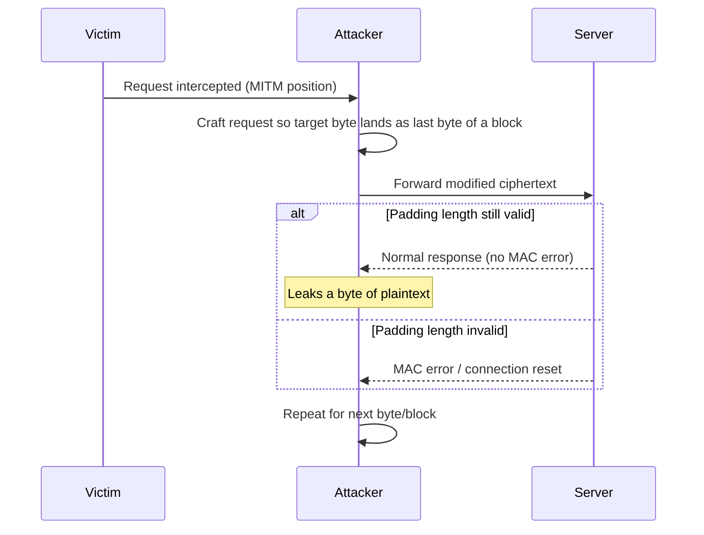

Both POODLE and BEAST are attacks that exploit structural weaknesses in how CBC mode was implemented in legacy SSL/TLS versions. Neither targets the underlying cryptographic algorithms directly, they abuse protocol-level flaws in padding handling and IV generation that were only fixed in later TLS revisions.

|Attack|Year|Targets|Root Cause|
|---|---|---|---|
|POODLE|2014|SSL 3.0|Arbitrary, unauthenticated padding bytes|
|BEAST|2011|TLS 1.0|Predictable, chained IVs|

---

## POODLE

POODLE (Padding Oracle On Downgraded Legacy Encryption) is a padding oracle attack targeting SSL 3.0's CBC padding scheme. Exploiting it lets an attacker decrypt intercepted ciphertext, recovering sensitive data such as session cookies or credentials, without needing the encryption key.

### SSL 3.0 Padding Scheme

SSL 3.0 pads the last block so that the final byte encodes the padding length, excluding the length byte itself, but every other padding byte can hold any arbitrary value. This is the core design flaw, unlike schemes where every padding byte must match a specific value (such as PKCS#7, where `03 03 03` is the only valid encoding of a 3-byte pad), SSL 3.0 only checks the last byte.

For an 8-byte block and a 4-byte plaintext `DE AD BE EF`, 4 bytes of padding are required. The last byte must be `03` (length excluding itself), but the three preceding bytes can be anything:

```
DE AD BE EF 00 00 00 03   <- valid
DE AD BE EF AA BB CC 03   <- also valid
```

If the plaintext length is already a multiple of the block size, a full extra block of padding must still be appended, since a padding length of zero bytes is not permitted at all.

### Exploitation Logic

The attacker needs to be in a position to intercept and manipulate ciphertext in transit, and must be able to force the victim's browser to repeatedly send requests, typically via injected JavaScript on a page the victim visits, making this a man-in-the-middle style attack rather than a purely passive one.



The attacker forces the victim to send a request padded to fill a full block, meaning the attacker already knows what the final padding byte should be, it's simply the block's padding length. The attacker then intercepts the ciphertext and swaps out the last block of one of the preceding ciphertext blocks with a target block they want to decrypt.

Because SSL 3.0 does not verify the content of padding bytes beyond the length field, if the substitution happens to produce a last byte that still decodes to a length matching an otherwise plausible padding, the server accepts it and processes the message normally, computing the MAC without error. If the substitution produces an invalid padding length, the computed MAC mismatches and the server returns a MAC error, immediately distinguishable from a valid response.

This valid-vs-invalid distinction is exactly the oracle, it leaks an intermediate CBC value exactly like a textbook padding oracle attack, allowing recovery of one plaintext byte per successful guess. Repeating the process recursively across bytes and then blocks eventually decrypts the targeted ciphertext in full.

### Identifying and Exploiting POODLE

TLS-Breaker is a Java-based toolkit bundling exploits for several TLS-layer attacks, including POODLE detection. It requires JDK 11 specifically.

Installation:

```bash
sudo apt install maven
git clone https://github.com/tls-attacker/TLS-Breaker
cd TLS-Breaker/
mvn clean install -DskipTests=true
```

If multiple Java versions are installed, confirm the correct JDK 11 path is in use:

```bash
update-alternatives --list java
```

Run the POODLE detection module against a target:

```bash
java -jar apps/poodle-1.0.1.jar -connect 192.168.56.10:443
```

A vulnerable server still supports SSL 3.0 and completes the handshake:

```
Sending messages: CLIENT_HELLO,
Received Messages: SERVER_HELLO, CERTIFICATE, SERVER_HELLO_DONE,
Vulnerability status: VULNERABILITY_POSSIBLE
```

A patched server rejects the connection outright:

```
Sending messages: CLIENT_HELLO,
Received Messages: Alert(FATAL,HANDSHAKE_FAILURE),
Vulnerability status: NOT_VULNERABLE
```

Nmap's NSE scripts can also flag POODLE-vulnerable services during a routine scan, alongside other TLS checks:

```bash
nmap -p 443 --script ssl-poodle,ssl-heartbleed 192.168.56.10
```

---

## BEAST

BEAST (Browser Exploit Against SSL/TLS) exploits predictable initialization vectors (IVs) in TLS 1.0's CBC implementation. In TLS 1.0, the IV used for one record is derived from the ciphertext of the previous record, making IVs predictable to anyone observing the encrypted traffic stream, this predictability is what the attack abuses.

### Exploitation Logic

The attacker intercepts a legitimately encrypted ciphertext block, then crafts and injects a new ciphertext using a known, predictable IV, allowing them to test guesses about the content of an unknown plaintext block by comparing the resulting ciphertext against the one they intercepted.

Brute-forcing an entire block at once is computationally infeasible for realistic block sizes, so BEAST relies on a refinement, injecting additional known characters into the plaintext stream (commonly via malicious JavaScript run in the victim's browser) to shift the byte alignment such that only a single unknown byte remains in a given block boundary. That single byte can then be brute-forced directly, and the process is repeated, shifting the alignment again to recover the next byte, continuing until the full secret (commonly a session cookie) is decrypted.

### Practical Limitations

Exploiting BEAST in the real world is significantly harder than POODLE. The attack requires the ability to inject chosen plaintext into the victim's traffic stream, which in a browser context requires first defeating the Same-Origin Policy to get attacker-controlled script execution in a context that can observe and interact with the target's traffic. This dependency on a separate SOP bypass as a prerequisite significantly limits BEAST's practical exploitability compared to a self-contained attack like POODLE.

---

## Prevention

Both attacks are fully mitigated by disabling the vulnerable protocol versions entirely, SSL 3.0 for POODLE and TLS 1.0 for BEAST, since both flaws were fixed in the TLS 1.1/1.2 redesign of CBC handling and are not present in modern cipher suites.

Simply having a server support newer TLS versions is not sufficient on its own. A client can still attempt to negotiate down to SSL 3.0 or TLS 1.0 through handshake manipulation, so legacy protocol versions must be explicitly disabled server-side rather than just deprioritized, closing off the downgrade path entirely.

On Apache, restricting supported protocols to TLS 1.2 and 1.3 only:

```bash
SSLProtocol -all +TLSv1.2 +TLSv1.3
```