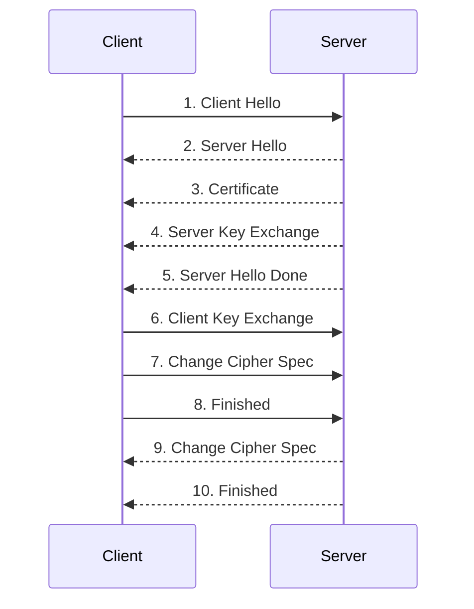

## Cipher Suites

A cipher suite is the set of cryptographic algorithms negotiated for a TLS connection. It defines four things, the key exchange algorithm, the authentication method, the symmetric encryption algorithm and mode, and the MAC algorithm used for integrity protection.

Take `TLS_DH_RSA_WITH_AES_128_CBC_SHA256` as an example. Breaking down the name reveals the full set of algorithms in use, key exchange via Diffie-Hellman (DH), server authentication via RSA, symmetric encryption via AES-128 in CBC mode, and integrity via a SHA256-based HMAC. All TLS 1.2 cipher suite names follow this same structure.

The reason encryption of actual application data is always symmetric (AES, 3DES, ChaCha20) rather than asymmetric is performance, symmetric algorithms are orders of magnitude faster for bulk data. Asymmetric cryptography is instead used during the handshake, specifically for the key exchange algorithm, to securely establish the symmetric key both parties will use afterward.

### Perfect Forward Secrecy

Cipher suites using ephemeral key exchange algorithms, `TLS_DHE` or `TLS_ECDHE`, provide Perfect Forward Secrecy (PFS). This means that even if an attacker later obtains the server's long-term private key, they cannot retroactively decrypt previously captured traffic, since each session used a fresh, ephemeral key that was never derived from or dependent on the server's static key.

Without PFS, an attacker who records encrypted traffic today and later compromises the server's private key can decrypt that old traffic retroactively. This makes PFS-capable cipher suites strongly preferable whenever supported by both client and server, and their absence is a common finding in TLS configuration reviews.

---

## Handshake Flow

The TLS 1.2 handshake establishes a secure channel by negotiating protocol version, cipher suite, authenticating the server, and deriving a shared symmetric key, all before any application data is exchanged.

### ClientHello

The client initiates the handshake by sending a `ClientHello` message. This contains the highest TLS version the client supports and the full list of cipher suites it is willing to use.

### ServerHello

The server responds with `ServerHello`, selecting a TLS version equal to or lower than what the client offered, and choosing one cipher suite from the client's list. This selection determines every subsequent step of the handshake.

### Certificate

The server proves its identity by sending its certificate (and the rest of the certificate chain) in the `Certificate` message, which the client validates against its trust store as covered in PKI fundamentals.

### Key Exchange

If the negotiated cipher suite provides PFS, the server sends a `ServerKeyExchange` message containing fresh key material (a key share) along with a signature proving it was generated by the legitimate server, followed by `ServerHelloDone`. The client then replies with `ClientKeyExchange`, containing its own key share.

If the cipher suite does not provide PFS (for example, a `TLS_RSA` suite), there is no `ServerKeyExchange` message at all. Instead, the client directly generates a pre-master secret, encrypts it with the server's RSA public key (taken from the certificate), and sends it in `ClientKeyExchange`. Only the server, holding the matching private key, can decrypt it.

Either way, once this exchange completes, both sides independently derive the same symmetric session key from the shared secret material.

### Switching to Encrypted Communication

Both client and server send a `ChangeCipherSpec` message, signaling that every message from that point forward will be encrypted and MAC-protected using the freshly derived symmetric key.

### Finished

The handshake concludes with `Finished` messages from both sides. These are already encrypted using the newly established channel, and their purpose is to prove that the key exchange and authentication succeeded and that no tampering occurred during the handshake, since any modification to earlier handshake messages would cause this verification to fail.




---

## Analyzing a TLS 1.2 Handshake in Wireshark

Wireshark is useful for inspecting a captured handshake packet by packet, which helps in understanding exactly which cipher suite was negotiated and what key material was exchanged, something relevant both for protocol study and for diagnosing TLS misconfigurations during an assessment.

### Installation

```bash
sudo apt install wireshark
```

### Basic Usage

Open a capture file directly from the command line:

```bash
wireshark /path/to/capture.pcap
```

Once loaded, filter the packet list down to TLS traffic only:

```
tls
```

This isolates the handshake messages, `Client Hello`, `Server Hello`, `Certificate`, `Key Exchange`, and `Change Cipher Spec`, in sequence.

### Inspecting Negotiated Parameters

Expanding the `Client Hello` message reveals the TLS version and the full list of cipher suites the client offered, for example entries like `TLS_RSA_WITH_AES_128_CBC_SHA` among others.

Expanding `Server Hello` shows which single cipher suite the server actually selected from that list, for instance `TLS_RSA_WITH_3DES_EDE_CBC_SHA`, along with any TLS extensions negotiated for the session.

### Inspecting the Key Exchange

Expanding `Client Key Exchange` shows the actual key material sent by the client. When a `TLS_RSA` cipher suite is in use (no PFS), this field contains the pre-master secret encrypted directly with the server's RSA public key, visible as an "RSA Encrypted PreMaster Secret" field with its encrypted length and value.

Note that in this scenario there is no `Server Key Exchange` message in the capture at all, which is expected and confirms the cipher suite does not provide PFS, since the server has nothing additional to contribute beyond its static certificate.