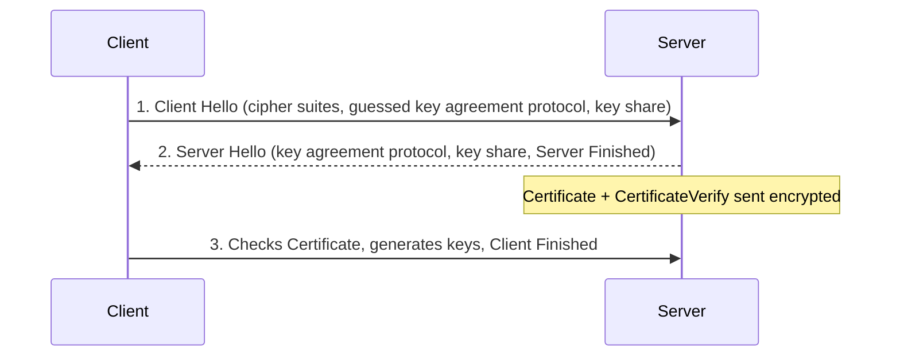

**TLS 1.3** is a significant redesign over TLS 1.2, focused on reducing cryptographic complexity and speeding up connection establishment. It removes support for legacy, insecure cryptographic parameters entirely, instead of just deprecating them, and restructures the handshake to require fewer round trips before application data can flow.

### Cipher Suites

TLS 1.3 only supports key exchange algorithms that provide Perfect Forward Secrecy, eliminating the non-PFS `TLS_RSA` style suites that existed in TLS 1.2. This alone removes an entire class of weak configurations from being negotiable at all.

Cipher suite naming is also much simpler. A typical TLS 1.3 suite looks like this:

```
TLS_AES_128_GCM_SHA256
```

Compared to TLS 1.2 naming, this only specifies the symmetric encryption algorithm and mode (AES-128-GCM) and the hash function used for key derivation (SHA256). The key exchange algorithm and authentication method are no longer part of the cipher suite name, since they are negotiated separately via supported groups and certificate type extensions instead.

---

## Handshake Flow

The TLS 1.3 handshake compresses what took multiple round trips in TLS 1.2 into effectively one, by having the client guess and immediately send key material instead of waiting for the server to confirm parameters first.



### Client Hello

The handshake still opens with `ClientHello`, but this message now carries far more than in TLS 1.2. Alongside the supported cipher suites, the client includes a key share extension containing its guessed key exchange material up front, rather than waiting for a later `ClientKeyExchange` message, which no longer exists in TLS 1.3.

Since the client does not yet know which group the server will select, it typically sends multiple key shares for different groups, for example both `x25519` and `secp256r1`, to maximize the chance that one of them matches what the server picks.

### Server Hello and Key Share

The server responds with `ServerHello`, confirming the chosen key agreement protocol and cipher suite, and including its own key share for the specific group it selected. This directly replaces the TLS 1.2 `ServerKeyExchange` message, since a fresh key share here is mandatory, TLS 1.3 cannot negotiate a non-PFS connection.

### Certificate and CertificateVerify

Immediately after `ServerHello`, the server sends its `Certificate` message, but critically, this is already encrypted, since the shared key material from the `ServerHello` key share is enough to start encrypting the rest of the handshake. This is a major structural difference from TLS 1.2, where the certificate was sent in plaintext.

Following the certificate, the server sends `CertificateVerify`, a signature computed over the handshake transcript that proves possession of the private key corresponding to the presented certificate. This message effectively replaces the signature that TLS 1.2 embedded directly inside `ServerKeyExchange`.

### Finished Messages

The handshake concludes with `Finished` messages from both sides, confirming the negotiation succeeded and the transcript was not tampered with, same purpose as in TLS 1.2, but reached in far fewer total messages.

---

## Analyzing a TLS 1.3 Handshake in Wireshark

Capturing a TLS 1.3 handshake highlights the structural differences from TLS 1.2 immediately. Filtering on `tls` shows `Client Hello`, `Server Hello`, `Change Cipher Spec`, and then directly `Application Data`, there is no separate `Client Key Exchange` message visible, since that function is folded into the initial `Client Hello`.

### Inspecting the Client Key Share

Expanding the `key_share` extension inside `Client Hello` reveals the groups the client is offering key material for. It is common to see two separate entries, for example one for `x25519` and one for `secp256r1`, each with its own key exchange value, confirming the client is hedging its guess since it does not yet know which group the server will choose.

### Inspecting the Server Key Share

The corresponding `key_share` extension inside `Server Hello` shows only a single entry, since by this point the server has already committed to one specific group, for example `x25519`, and only needs to transmit its key share for that chosen group.

### Encrypted Application Data

From the `Change Cipher Spec` message onward, all captured traffic is tagged as `Application Data` (specifically `Encrypted Application Data`), confirming that the certificate exchange and everything following it, unlike in TLS 1.2, never appears in plaintext on the wire.